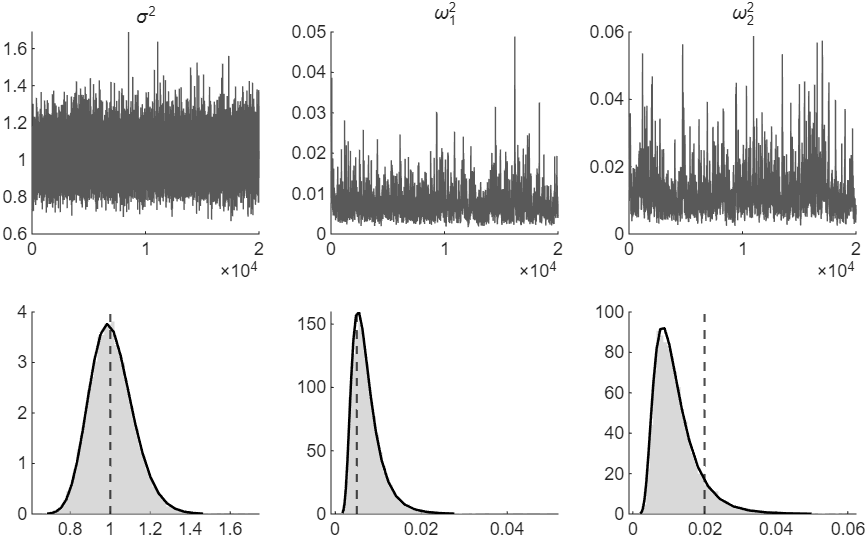

# How to Estimate a TVP Regression by Gibbs Sampling

*Code: [`guide.m`](guide.m), with [`ssm.simulate_states`](../../core/+ssm/simulate_states.m),
[`ssm.surform`](../../core/+ssm/surform.m), [`ssm.diffmat`](../../core/+ssm/diffmat.m) and
[`ssm.inefficiency_factor`](../../core/+ssm/inefficiency_factor.m). Method:
[Chan and Jeliazkov (2009)](../../CITING.md#chan-and-jeliazkov-2009) and
[Chan (forthcoming)](../../CITING.md#chan-forthcoming).*

We estimate the time-varying parameter (TVP) regression of
[How to Draw Time-Varying Regression Coefficients](../tvp_states/) by Gibbs sampling, on the data
of that guide. That guide holds the error variance $`\sigma^2`$, the variances $`\omega_i^2`$ of
the random walks and the initial coefficients $`\boldsymbol{\beta}_0`$ at their true values. Here
we estimate them along with the coefficients.

A Gibbs sampler draws the unknowns of a model in blocks and repeats. Each block is drawn from its
distribution given the data and the current values of the other blocks.
[How to Estimate a State Space Model by Gibbs Sampling](../gibbs_sampler/) builds one for the
local level model. Each iteration of our sampler draws the path of the coefficients as in the
first guide, and then the parameters, each from a standard distribution.

To draw the figure first, run from the root of the repository:

```matlab
run guides/tvp_gibbs/guide.m
```

## The Model and Its Priors

The model is that of the first guide,

$$y_t = \mathbf{x}_t'\boldsymbol{\beta}_t + \varepsilon_t, \qquad \varepsilon_t \sim \mathcal{N}(0, \sigma^2), \qquad\qquad \boldsymbol{\beta}_t = \boldsymbol{\beta}_{t-1} + \boldsymbol{\eta}_t, \qquad \boldsymbol{\eta}_t \sim \mathcal{N}(\mathbf{0}, \boldsymbol{\Omega}),$$

with $`\sigma^2`$, $`\boldsymbol{\Omega} = \mathrm{diag}(\omega_1^2, \ldots, \omega_k^2)`$ and
$`\boldsymbol{\beta}_0`$ unknown. The priors are

$$\boldsymbol{\beta}_0 \sim \mathcal{N}(\mathbf{a}_0, \mathbf{V}_0), \qquad \sigma^2 \sim \mathcal{IG}(\nu_{\sigma^2}, S_{\sigma^2}), \qquad \omega_i^2 \sim \mathcal{IG}(\nu_{\omega^2}, S_{\omega_i^2}), \quad i = 1, \ldots, k,$$

where $`\mathcal{IG}(\nu, S)`$ is the inverse-gamma distribution with shape $`\nu`$ and scale
$`S`$, and the $`\omega_i^2`$ are independent. We assume $`\mathbf{a}_0 = \mathbf{0}`$,
$`\mathbf{V}_0 = 100\,\mathbf{I}_k`$, the shapes $`\nu_{\sigma^2} = \nu_{\omega^2} = 3`$ and the
scales $`S_{\sigma^2} = 2`$ and $`S_{\omega_i^2} = 0.02`$. The prior means of $`\sigma^2`$ and of
each $`\omega_i^2`$ are then 1 and 0.01. The data are those of the first guide, generated with
$`T = 200`$, an intercept and one regressor, $`\sigma^2 = 1`$,
$`\boldsymbol{\Omega} = \mathrm{diag}(0.005, 0.02)`$ and $`\boldsymbol{\beta}_0 = (2, 1)'`$.

## Step 1: Split the Unknowns into Blocks

The unknowns are the stacked coefficients
$`\boldsymbol{\beta} = (\boldsymbol{\beta}_1', \ldots, \boldsymbol{\beta}_T')'`$ and the
parameters $`\sigma^2`$, $`\omega_1^2, \ldots, \omega_k^2`$ and $`\boldsymbol{\beta}_0`$. Given
the parameters, the coefficients are Gaussian with a banded precision matrix. Given the
coefficients, each parameter has a standard distribution. The sampler therefore cycles through
four blocks:

1.  $`(\boldsymbol{\beta} \mid \mathbf{y}, \sigma^2, \boldsymbol{\Omega}, \boldsymbol{\beta}_0)`$,
   a Gaussian distribution, from the first guide;
2.  $`(\sigma^2 \mid \mathbf{y}, \boldsymbol{\beta})`$, an inverse-gamma distribution;
3.  $`(\omega_i^2 \mid \boldsymbol{\beta}, \boldsymbol{\beta}_0)`$ for $`i = 1, \ldots, k`$,
   inverse-gamma distributions, independent of each other given the coefficients;
4.  $`(\boldsymbol{\beta}_0 \mid \boldsymbol{\beta}_1, \boldsymbol{\Omega})`$, a Gaussian
   distribution.

## Step 2: Derive the Conditional Distributions

**The coefficients.** Given the parameters, $`\mathbf{K}`$ and $`\mathbf{c}`$ are those of the
first guide, evaluated at the current values of $`\sigma^2`$, $`\boldsymbol{\Omega}`$ and
$`\boldsymbol{\beta}_0`$. [`ssm.simulate_states`](../../core/+ssm/simulate_states.m) takes one
draw.

**The variances.** Given the coefficients, the measurement errors
$`\boldsymbol{\varepsilon} = \mathbf{y} - \mathbf{Z}\boldsymbol{\beta}`$ are known. So are the
changes $`\eta_{it} = \beta_{it} - \beta_{i,t-1}`$ of each coefficient, where $`\beta_{i0}`$ is
entry $`i`$ of $`\boldsymbol{\beta}_0`$. Each variance is then the variance of a normal sample
with known mean zero, for which the inverse-gamma prior is conjugate:

$$(\sigma^2 \mid \mathbf{y}, \boldsymbol{\beta}) \sim \mathcal{IG}\Big(\nu_{\sigma^2} + \frac{T}{2},\; S_{\sigma^2} + \frac{\boldsymbol{\varepsilon}'\boldsymbol{\varepsilon}}{2}\Big), \qquad (\omega_i^2 \mid \boldsymbol{\beta}, \boldsymbol{\beta}_0) \sim \mathcal{IG}\Big(\nu_{\omega^2} + \frac{T}{2},\; S_{\omega_i^2} + \frac{1}{2}\sum_{t=1}^{T}\eta_{it}^2\Big).$$

Each $`\omega_i^2`$ depends only on the path of its own coefficient. The code draws from
$`\mathcal{IG}(\nu, S)`$ as `1/gamrnd(nu, 1/S)`, as in
[How to Estimate a State Space Model by Gibbs Sampling](../gibbs_sampler/).

**The initial coefficients.** $`\boldsymbol{\beta}_0`$ enters only the first state equation,
$`\boldsymbol{\beta}_1 = \boldsymbol{\beta}_0 + \boldsymbol{\eta}_1`$. Since $`\mathbf{V}_0`$ and
$`\boldsymbol{\Omega}`$ are diagonal, the recipe of the first guide applies to each coefficient on
its own. The equation $`\beta_{i0} = \beta_{i1} - \eta_{i1}`$ has
$`(\mathbf{A}, \mathbf{d}, \mathbf{S}) = (1, \beta_{i1}, \omega_i^2)`$, and the prior
$`\beta_{i0} = a_{0i} + e_{0i}`$ with $`e_{0i} \sim \mathcal{N}(0, V_{0i})`$ has
$`(1, a_{0i}, V_{0i})`$. Adding the two contributions gives

$$(\beta_{i0} \mid \beta_{i1}, \omega_i^2) \sim \mathcal{N}\big(K_i^{-1}c_i,\; K_i^{-1}\big), \qquad K_i = \frac{1}{V_{0i}} + \frac{1}{\omega_i^2}, \qquad c_i = \frac{a_{0i}}{V_{0i}} + \frac{\beta_{i1}}{\omega_i^2}.$$

## Step 3: Write the Loop

```matlab
a0 = zeros(k,1); V0 = 100*ones(k,1);                   % beta_0 ~ N(a0, diag(V0))
nu_sig = 3; S_sig = 2;                                 % sig2 ~ IG(nu_sig, S_sig)
nu_om = 3; S_om = .02*ones(k,1);                       % omega_i^2 ~ IG(nu_om, S_om(i))
nsim = 20000; burnin = 1000;
Z = ssm.surform(X); ZZ = Z'*Z; Zy = Z'*y;              % computed once
H = kron(ssm.diffmat(T), speye(k));                    % H = H_T kron I_k
sig2 = var(y); omega2 = .01*ones(k,1); b0 = a0;        % starting values
store_theta = zeros(nsim, 1 + 2*k); store_beta = zeros(k*T, nsim);
for isim = 1:burnin + nsim
    iS = kron(speye(T), spdiags(1./omega2, 0, k, k));  % S^{-1} = I_T kron Omega^{-1}
    btil = [b0; zeros((T-1)*k,1)];                     % betatilde_0 = (beta_0', 0', ..., 0')'
    K = H'*iS*H + ZZ/sig2;                             % the coefficients: guides/tvp_states
    c = H'*iS*btil + Zy/sig2;
    beta = ssm.simulate_states(K, c);

    e = y - Z*beta;  % the measurement errors
    sig2 = 1/gamrnd(nu_sig + T/2, 1/(S_sig + e'*e/2));

    eta = reshape(H*beta - btil, k, T);  % the state errors, a row per coefficient
    omega2 = 1./gamrnd(nu_om + T/2, 1./(S_om + sum(eta.^2, 2)/2));

    Kb0 = 1./V0 + 1./omega2;  % beta_0 given beta_1 and Omega
    b0 = (a0./V0 + beta(1:k)./omega2)./Kb0 + randn(k,1)./sqrt(Kb0);

    if isim > burnin
        store_theta(isim - burnin, :) = [sig2 omega2' b0'];
        store_beta(:, isim - burnin) = beta;
    end
end
```

The matrices $`\mathbf{Z}'\mathbf{Z}`$ and $`\mathbf{Z}'\mathbf{y}`$ do not depend on the
parameters, so they are computed once. $`\mathbf{K}`$ and $`\mathbf{c}`$ are rebuilt at every
iteration from the current parameters. The draws of the $`\omega_i^2`$ are vectorized: `gamrnd`
takes the vector of scales and returns one draw for each coefficient. The chain starts from
$`\sigma^2`$ equal to the sample variance of $`y_t`$, $`\omega_i^2 = 0.01`$ and
$`\boldsymbol{\beta}_0 = \mathbf{0}`$. The first 1,000 iterations are discarded as burn-in.

## Step 4: Check the Chain

In Figure 1, the draws of each variance fluctuate around a stable level throughout, with no drift.
Computed by [`ssm.inefficiency_factor`](../../core/+ssm/inefficiency_factor.m) with Bartlett
weights up to lag 200, the inefficiency factors are 2.3 for $`\sigma^2`$, 35.8 for $`\omega_1^2`$
and 43.9 for $`\omega_2^2`$. The 20,000 draws of $`\omega_2^2`$ thus carry about as much
information as 460 independent draws. As in the local level model, the draws of each
$`\omega_i^2`$ are the most correlated. The sampler draws $`\omega_i^2`$ given the path of
coefficient $`i`$, and the path given $`\omega_i^2`$, and the two depend strongly on each other in
the posterior.

| | True value | Posterior mean | 90% interval | Inefficiency factor |
|---|---|---|---|---|
| $`\sigma^2`$ | 1 | 1.01 | (0.84, 1.20) | 2.3 |
| $`\omega_1^2`$ | 0.005 | 0.0074 | (0.0034, 0.0141) | 35.8 |
| $`\omega_2^2`$ | 0.02 | 0.0123 | (0.0053, 0.0247) | 43.9 |
| $`\beta_{10}`$ | 2 | 1.81 | (1.30, 2.33) | 25.6 |
| $`\beta_{20}`$ | 1 | 0.64 | (0.05, 1.28) | 22.6 |

Every true value lies inside its 90 percent interval. The intervals of $`\boldsymbol{\beta}_0`$
are wide because the data inform $`\boldsymbol{\beta}_0`$ only through the coefficients of the
first periods.



*Figure 1: Top, the 20,000 draws of $`\sigma^2`$, $`\omega_1^2`$ and $`\omega_2^2`$ kept after the
burn-in, in the order the sampler makes them. Bottom, their histograms, the posterior densities
computed on a grid without the sampler (solid lines; see How We Check It) and the true values
(dashed lines).*

The coefficients estimated with the parameters unknown are close to those of the first guide,
where the parameters are known. The posterior means differ by at most 0.92 posterior standard
deviations. For the intercept, the 90 percent intervals average 0.71 in width, against 0.62 with
the parameters known. They contain the true intercept in 183 and 180 of the 200 periods. For the
slope, they average 0.82 and 0.90 and contain the true slope in 172 and 179 periods. The slope's
intervals are narrower with the parameters estimated because the posterior mean of $`\omega_2^2`$,
0.0123, is below its true value of 0.02.

## How We Check It

<details>
<summary>The posterior of the variances on a grid, computed without the sampler</summary>

With $`\boldsymbol{\beta}_0`$ moved into the states,
$`\boldsymbol{\alpha} = (\boldsymbol{\beta}_0', \boldsymbol{\beta}_1', \ldots, \boldsymbol{\beta}_T')'`$,
the model is linear Gaussian given $`\sigma^2`$ and $`\boldsymbol{\Omega}`$. The prior of
$`\boldsymbol{\beta}_0`$ becomes the first state equation,
$`\boldsymbol{\beta}_0 = \mathbf{a}_0 + \mathbf{e}_0`$, and the prior of $`\boldsymbol{\alpha}`$
has a banded precision matrix. [`ssm.intlike`](../../core/+ssm/intlike.m) then returns the
likelihood $`p(\mathbf{y} \mid \sigma^2, \omega_1^2, \omega_2^2)`$ with $`\boldsymbol{\alpha}`$
integrated out, which
[How to Compute the Integrated Likelihood of a State Space Model](../integrated_likelihood/)
explains. `guide.m` multiplies it by the priors on a 40 × 40 × 40 grid of $`\log\sigma^2`$,
$`\log\omega_1^2`$ and $`\log\omega_2^2`$, and normalizes. The grid spans 6 standard deviations of
the logged draws on either side of their mean. The largest weight on a face of the grid is 4e-7 of
the largest weight.

The posterior means of the Gibbs draws differ from the grid values by at most 1.3 Monte Carlo
standard errors, computed by [`ssm.mcse`](../../core/+ssm/mcse.m). Their standard deviations
differ by at most 4.9 percent for the variances. For the coefficients, the grid gives
$`E(\boldsymbol{\beta} \mid \mathbf{y})`$ as the weighted average of the conditional means that
`ssm.intlike` returns. The largest of the 400 differences from the Gibbs means is 3.4 Monte Carlo
standard errors. The largest of 400 standard normal draws exceeds 3.4 in absolute value about one
time in four.

</details>

## Adapt It Yourself

Make the slope constant, $`\beta_{2t} = \beta_2`$ in every period, with the prior
$`\beta_2 \sim \mathcal{N}(0, 100)`$, so that only the intercept follows a random walk. Which
blocks change, and what is the new one?

<details>
<summary>Answer</summary>

The block of $`\omega_2^2`$ goes, and the slope leaves the states for a block of its own. The
intercept $`\boldsymbol{\tau} = (\beta_{11}, \ldots, \beta_{1T})'`$ is then the trend of a local
level model on $`y_t - \beta_2 x_t`$. The recipe of
[How to Draw the States of an Unobserved Components Model](../uc_states/) draws it. Given the
intercept, the slope is the coefficient of a regression of $`\mathbf{y} - \boldsymbol{\tau}`$ on
$`\mathbf{x} = (x_1, \ldots, x_T)'`$ with a normal prior:

$$(\beta_2 \mid \mathbf{y}, \boldsymbol{\tau}, \sigma^2) \sim \mathcal{N}\big(K_{\beta_2}^{-1}c_{\beta_2},\; K_{\beta_2}^{-1}\big), \qquad K_{\beta_2} = \frac{1}{100} + \frac{\mathbf{x}'\mathbf{x}}{\sigma^2}, \qquad c_{\beta_2} = \frac{\mathbf{x}'(\mathbf{y} - \boldsymbol{\tau})}{\sigma^2}.$$

The draws of $`\sigma^2`$, $`\omega_1^2`$ and $`\beta_{10}`$ keep their forms, with
$`\varepsilon_t = y_t - \beta_{1t} - \beta_2x_t`$. In the loop, these lines replace the draws of
the coefficients and of $`\sigma^2`$:

```matlab
K = HH1/om2 + speye(T)/sig2;  % the intercept: uc_states on y - b2*x
c = H1'*[b10; zeros(T-1,1)]/om2 + (y - b2*x)/sig2;
tau = ssm.simulate_states(K, c);

Kb2 = 1/Vs + x'*x/sig2;  % the constant slope: a regression
b2 = (as/Vs + x'*(y - tau)/sig2)/Kb2 + randn/sqrt(Kb2);

e = y - tau - b2*x;
sig2 = 1/gamrnd(nu_sig + T/2, 1/(S_sig + e'*e/2));
```

Here `H1 = ssm.diffmat(T)`, `HH1 = H1'*H1`, and `as = 0` and `Vs = 100` set the prior of the
slope. `guide.m` runs this sampler on data generated with a constant slope of 1 and the intercept
of the first guide. It checks the sampler against the posterior on a grid of
$`(\sigma^2, \omega_1^2)`$, with the slope in the states. The posterior means agree to within 2.4
Monte Carlo standard errors. The posterior mean of the slope is 0.93, with 90 percent interval
(0.82, 1.05).

</details>

## Next

The next guide in this series compares the model with a constant slope and the TVP regression by
their marginal likelihoods. Among the examples, [ex03](../../examples/ex03_tvp_regression.m) runs
this sampler on a Phillips curve for US PCE inflation.

## Using This Method in Your Research

The sampler draws the coefficients by the precision sampler of Chan and Jeliazkov (2009), and Chan
(forthcoming) gives its textbook treatment for the TVP regression. [`CITING.md`](../../CITING.md)
lists the paper behind each function of the toolkit and how to cite the toolkit itself.

## References

Chan, J. C. C. (forthcoming). *Bayesian Macroeconometrics: Methods and Applications*. Chapman &
Hall/CRC. [Code repository](https://github.com/joshuaccchan/bayesian-macroeconometrics)

Chan, J. C. C. and Jeliazkov, I. (2009). Efficient Simulation and Integrated Likelihood Estimation
in State Space Models. *International Journal of Mathematical Modelling and Numerical
Optimisation*, 1(1/2): 101-120.
[doi:10.1504/IJMMNO.2009.030090](https://doi.org/10.1504/IJMMNO.2009.030090)
