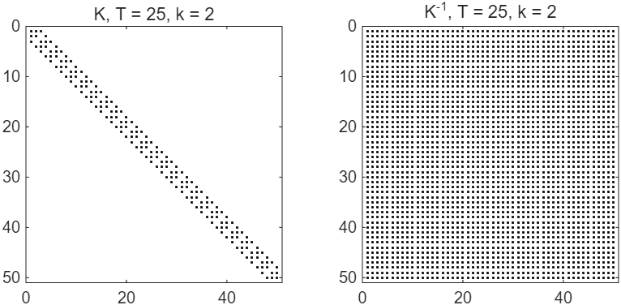
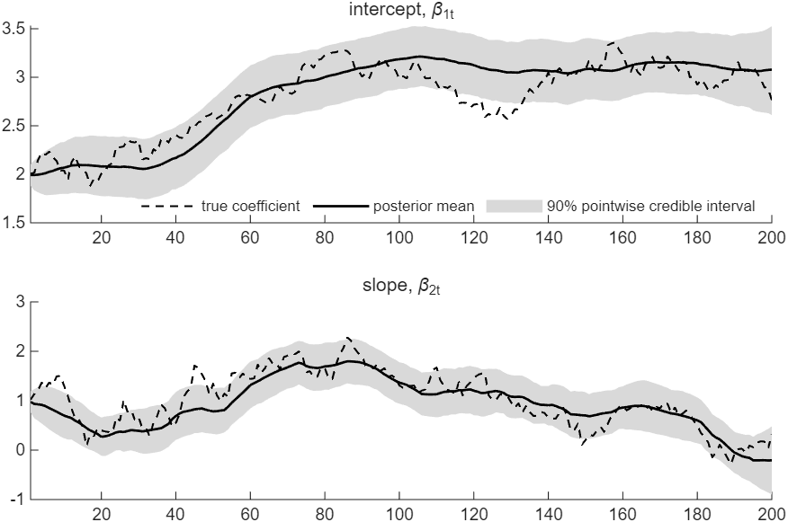
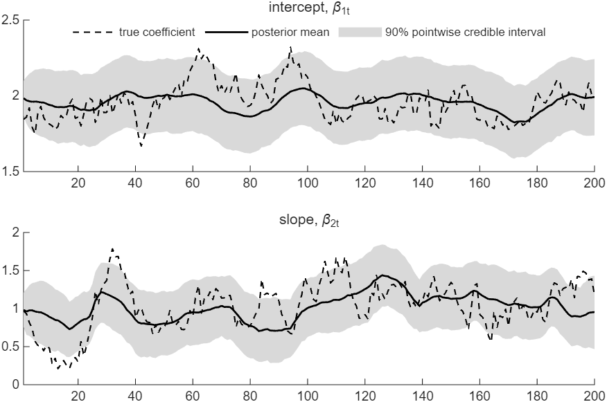

# How to Draw Time-Varying Regression Coefficients

*Code: [`guide.m`](guide.m), with [`ssm.simulate_states`](../../core/+ssm/simulate_states.m),
[`ssm.surform`](../../core/+ssm/surform.m) and [`ssm.diffmat`](../../core/+ssm/diffmat.m). Method:
[Chan and Jeliazkov (2009)](../../CITING.md#chan-and-jeliazkov-2009) and
[Chan (forthcoming)](../../CITING.md#chan-forthcoming).*

In a time-varying parameter (TVP) regression, the coefficients change over time. A state equation
sets how they change, for example as random walks or as stationary autoregressions. Steps 1 to 3
let each coefficient follow its own random walk, and Step 4 lets the coefficients revert to a
mean. The coefficients of all periods together form the states: $`k`$ numbers per period, $`kT`$
in all. The precision sampler draws this whole path at once, in the same three steps as in
[How to Draw the States of an Unobserved Components Model](../uc_states/). Stack the equations,
read the precision matrix $`\mathbf{K}`$ and the vector $`\mathbf{c}`$ off the log density, and
call [`ssm.simulate_states`](../../core/+ssm/simulate_states.m). The new parts are the stacked
design matrix and the order of the states. In this guide the parameters are known; the next guide
in this series draws them as well.

To draw the figures first, run from the root of the repository:

```matlab
run guides/tvp_states/guide.m
```

## The TVP Regression

The model is

$$y_t = \mathbf{x}_t'\boldsymbol{\beta}_t + \varepsilon_t, \qquad \varepsilon_t \sim \mathcal{N}(0, \sigma^2), \qquad\qquad \boldsymbol{\beta}_t = \boldsymbol{\beta}_{t-1} + \boldsymbol{\eta}_t, \qquad \boldsymbol{\eta}_t \sim \mathcal{N}(\mathbf{0}, \boldsymbol{\Omega}),$$

where $`\mathbf{x}_t`$ holds $`k`$ regressors,
$`\boldsymbol{\Omega} = \mathrm{diag}(\omega_1^2, \ldots, \omega_k^2)`$, and the coefficients
start from a known $`\boldsymbol{\beta}_0`$. Each variance $`\omega_i^2`$ sets how fast
coefficient $`i`$ moves. Here we generate $`T = 200`$ observations with an intercept and one
regressor, $`\mathbf{x}_t = (1, x_t)'`$ with $`x_t \sim \mathcal{N}(0, 1)`$, and set
$`\sigma^2 = 1`$, $`\boldsymbol{\Omega} = \mathrm{diag}(0.005, 0.02)`$ and
$`\boldsymbol{\beta}_0 = (2, 1)'`$.

## Step 1: Stack the Equations

Stack the coefficients by period,
$`\boldsymbol{\beta} = (\boldsymbol{\beta}_1', \ldots, \boldsymbol{\beta}_T')'`$. The measurement
equation becomes $`\mathbf{y} = \mathbf{Z}\boldsymbol{\beta} + \boldsymbol{\varepsilon}`$ with
$`\boldsymbol{\varepsilon} \sim \mathcal{N}(\mathbf{0}, \sigma^2\mathbf{I}_T)`$ and the
$`T \times kT`$ block-diagonal matrix

$$\mathbf{Z} = \begin{bmatrix} \mathbf{x}_1' & \mathbf{0} & \cdots & \mathbf{0} \\ \mathbf{0} & \mathbf{x}_2' & \cdots & \mathbf{0} \\ \vdots & & \ddots & \vdots \\ \mathbf{0} & \mathbf{0} & \cdots & \mathbf{x}_T' \end{bmatrix},$$

which [`ssm.surform`](../../core/+ssm/surform.m) returns as a sparse matrix. The state equation,
written as $`\boldsymbol{\beta}_1 - \boldsymbol{\beta}_0 = \boldsymbol{\eta}_1`$ and
$`\boldsymbol{\beta}_t - \boldsymbol{\beta}_{t-1} = \boldsymbol{\eta}_t`$ for $`t > 1`$, stacks
into $`\mathbf{H}\boldsymbol{\beta} = \tilde{\boldsymbol{\beta}}_0 + \boldsymbol{\eta}`$ with
$`\boldsymbol{\eta} \sim \mathcal{N}(\mathbf{0}, \mathbf{S})`$,
$`\mathbf{S} = \mathbf{I}_T \otimes \boldsymbol{\Omega}`$ and
$`\tilde{\boldsymbol{\beta}}_0 = (\boldsymbol{\beta}_0', \mathbf{0}', \ldots, \mathbf{0}')'`$.
Here $`\mathbf{H} = \mathbf{H}_T \otimes \mathbf{I}_k`$, where $`\mathbf{H}_T`$ is the
$`T \times T`$ first-difference matrix that [`ssm.diffmat`](../../core/+ssm/diffmat.m) returns:
the Kronecker product takes the difference of each coefficient between consecutive periods.

## Step 2: Read $`\mathbf{K}`$ and $`\mathbf{c}`$ off the Log Density

The recipe of [How to Draw the States of an Unobserved Components Model](../uc_states/) applies
unchanged. An equation $`\mathbf{A}\boldsymbol{\beta} = \mathbf{d} + \mathbf{e}`$ with
$`\mathbf{e} \sim \mathcal{N}(\mathbf{0}, \mathbf{S})`$ adds
$`\mathbf{A}'\mathbf{S}^{-1}\mathbf{A}`$ to $`\mathbf{K}`$ and
$`\mathbf{A}'\mathbf{S}^{-1}\mathbf{d}`$ to $`\mathbf{c}`$. The measurement equation has
$`(\mathbf{A}, \mathbf{d}, \mathbf{S}) = (\mathbf{Z}, \mathbf{y}, \sigma^2\mathbf{I}_T)`$ and the
state equation
$`(\mathbf{H}, \tilde{\boldsymbol{\beta}}_0, \mathbf{I}_T \otimes \boldsymbol{\Omega})`$, so

$$\mathbf{K} = \mathbf{H}'\mathbf{S}^{-1}\mathbf{H} + \frac{1}{\sigma^2}\mathbf{Z}'\mathbf{Z}, \qquad \mathbf{c} = \mathbf{H}'\mathbf{S}^{-1}\tilde{\boldsymbol{\beta}}_0 + \frac{1}{\sigma^2}\mathbf{Z}'\mathbf{y},$$

with $`\mathbf{S}^{-1} = \mathbf{I}_T \otimes \boldsymbol{\Omega}^{-1}`$. In code, with each
formula beside the line that computes it:

```matlab
Z = ssm.surform(X);                  % Z = diag(x_1', ..., x_T')
H = kron(ssm.diffmat(T), speye(k));  % H = H_T kron I_k
iS = kron(speye(T), inv(Omega));     % S^{-1} = I_T kron Omega^{-1}
btil = [beta0; zeros((T-1)*k,1)];    % betatilde_0 = (beta_0', 0', ..., 0')'
K = H'*iS*H + Z'*Z/sig2;             % K = H'*S^{-1}*H + Z'*Z/sig2
c = H'*iS*btil + Z'*y/sig2;          % c = H'*S^{-1}*betatilde_0 + Z'*y/sig2
```

$`\mathbf{K}`$ is block tridiagonal, with $`k \times k`$ blocks. The state equation contributes
$`2\boldsymbol{\Omega}^{-1}`$ to each diagonal block but the last, which gets
$`\boldsymbol{\Omega}^{-1}`$, and $`-\boldsymbol{\Omega}^{-1}`$ to each block next to the
diagonal. The measurement equation adds $`\mathbf{x}_t\mathbf{x}_t'/\sigma^2`$ to diagonal block
$`t`$. On the generated data the top left corner of $`\mathbf{K}`$ is

$$\begin{bmatrix} 401.00 & -0.65 & -200 & 0 \\ -0.65 & 100.42 & 0 & -50 \\ -200 & 0 & 401.00 & 1.18 \\ 0 & -50 & 1.18 & 101.40 \end{bmatrix},$$

where $`2/0.005 = 400`$, $`2/0.02 = 100`$, $`1/0.005 = 200`$ and $`1/0.02 = 50`$, and the rest
comes from $`\mathbf{x}_1`$ and $`\mathbf{x}_2`$. Its lower bandwidth is $`k = 2`$, while
$`\mathbf{K}^{-1}`$ has no zero entries (Figure 1). We stack the coefficients by period to ensure
that $`\mathbf{K}`$ is banded.



*Figure 1: The nonzero entries of $`\mathbf{K}`$ and of $`\mathbf{K}^{-1}`$ for the TVP regression
with $`T = 25`$ and $`k = 2`$.*

## Step 3: Draw the Coefficients

```matlab
[draws, betahat] = ssm.simulate_states(K, c, 5000);  % 5,000 independent draws of the path
B = reshape(draws, k, T, []);                        % B(i,t,d): coefficient i, period t, draw d
```

Each column of `draws` is one draw of the stacked path. Since the path is stacked by period,
`reshape` turns the draws into a $`k \times T \times 5000`$ array. Its entry $`(i, t, d)`$ is
coefficient $`i`$ in period $`t`$ of draw $`d`$. As in the local level model, the Cholesky factor
of $`\mathbf{K}`$ has the same band. A draw then takes a number of operations proportional to
$`Tk^3`$, and $`\mathbf{K}^{-1}`$ is never formed.

The intervals follow the true coefficients closely (Figure 2). They are 0.63 wide on average for
the intercept and 0.90 for the slope. The slope is less precise because it moves faster. Also,
only the regressor $`x_t`$ carries information about it, and $`x_t`$ is close to zero in some
periods.



*Figure 2: The TVP regression on generated data, with $`T = 200`$, $`\sigma^2 = 1`$,
$`\boldsymbol{\Omega} = \mathrm{diag}(0.005, 0.02)`$ and $`\boldsymbol{\beta}_0 = (2, 1)'`$: the
true coefficients and their posterior means with 90 percent pointwise credible intervals, from
5,000 draws.*

## Step 4: Let the Coefficients Revert to a Mean

Random walks let the coefficients drift without bound. An alternative is to assume a stationary
process for $`\boldsymbol{\beta}_t`$ with unconditional mean $`\boldsymbol{\mu}`$, such as
$`\boldsymbol{\beta}_t - \boldsymbol{\mu} = \boldsymbol{\Phi}(\boldsymbol{\beta}_{t-1} - \boldsymbol{\mu}) + \boldsymbol{\eta}_t`$
with $`\boldsymbol{\Phi} = \mathrm{diag}(\phi_1, \ldots, \phi_k)`$ and each $`|\phi_i| < 1`$.
Written as
$`\boldsymbol{\beta}_t - \boldsymbol{\Phi}\boldsymbol{\beta}_{t-1} = (\mathbf{I}_k - \boldsymbol{\Phi})\boldsymbol{\mu} + \boldsymbol{\eta}_t`$,
the state equations stack into
$`\mathbf{H}_{\boldsymbol{\Phi}}\boldsymbol{\beta} = \tilde{\boldsymbol{\beta}} + \boldsymbol{\eta}`$,
where $`\mathbf{H}_{\boldsymbol{\Phi}} = \mathbf{I}_{kT} - \mathbf{L} \otimes \boldsymbol{\Phi}`$,
the lag matrix $`\mathbf{L}`$ has ones just below the diagonal and zeros elsewhere, and

$$\tilde{\boldsymbol{\beta}} = \big((\mathbf{I}_k - \boldsymbol{\Phi})\boldsymbol{\mu} + \boldsymbol{\Phi}\boldsymbol{\beta}_0, \; (\mathbf{I}_k - \boldsymbol{\Phi})\boldsymbol{\mu}, \; \ldots, \; (\mathbf{I}_k - \boldsymbol{\Phi})\boldsymbol{\mu}\big)'.$$

Only the state equation changes, and the recipe gives

$$\mathbf{K} = \mathbf{H}_{\boldsymbol{\Phi}}'\mathbf{S}^{-1}\mathbf{H}_{\boldsymbol{\Phi}} + \frac{1}{\sigma^2}\mathbf{Z}'\mathbf{Z}, \qquad \mathbf{c} = \mathbf{H}_{\boldsymbol{\Phi}}'\mathbf{S}^{-1}\tilde{\boldsymbol{\beta}} + \frac{1}{\sigma^2}\mathbf{Z}'\mathbf{y}.$$

Since $`\mathbf{H}_T = \mathbf{I}_T - \mathbf{L}`$, the lag matrix is `speye(T) - ssm.diffmat(T)`.
In code:

```matlab
L = speye(T) - ssm.diffmat(T);     % the lag matrix: ones below the diagonal
HPhi = speye(T*k) - kron(L, Phi);  % H_Phi = I - L kron Phi
btil = [(eye(k) - Phi)*mu + Phi*beta0; repmat((eye(k) - Phi)*mu, T-1, 1)];
K = HPhi'*iS*HPhi + Z'*Z/sig2;     % K = H_Phi'*S^{-1}*H_Phi + Z'*Z/sig2
c = HPhi'*iS*btil + Z'*y/sig2;     % c = H_Phi'*S^{-1}*betatilde + Z'*y/sig2
[draws, betahat] = ssm.simulate_states(K, c, 5000);
```

$`\mathbf{K}`$ keeps its lower bandwidth of 2. On data generated with $`\phi_1 = \phi_2 = 0.9`$
and $`\boldsymbol{\mu} = \boldsymbol{\beta}_0 = (2, 1)'`$, the coefficients stay close to their
means. The intervals are 0.48 wide on average for the intercept and 0.82 for the slope (Figure 3).



*Figure 3: Coefficients that revert to their means, with $`\phi_1 = \phi_2 = 0.9`$ and the other
parameters of Figure 2: the true coefficients and their posterior means with 90 percent pointwise
credible intervals.*

## How We Check It

<details>
<summary>The checks in guide.m, which form dense matrices that only a small example can afford</summary>

The coefficients are Gaussian a priori,
$`\boldsymbol{\beta} \sim \mathcal{N}(\mathbf{H}^{-1}\tilde{\boldsymbol{\beta}}_0, \mathbf{V})`$
with $`\mathbf{V} = \mathbf{H}^{-1}\mathbf{S}(\mathbf{H}')^{-1}`$, and
$`\mathbf{y} = \mathbf{Z}\boldsymbol{\beta} + \boldsymbol{\varepsilon}`$, so their conditional
distribution also has the covariance form

$$\mathcal{N}\big(\mathbf{m} + \mathbf{V}\mathbf{Z}'(\mathbf{Z}\mathbf{V}\mathbf{Z}' + \sigma^2\mathbf{I}_T)^{-1}(\mathbf{y} - \mathbf{Z}\mathbf{m}),\; \mathbf{V} - \mathbf{V}\mathbf{Z}'(\mathbf{Z}\mathbf{V}\mathbf{Z}' + \sigma^2\mathbf{I}_T)^{-1}\mathbf{Z}\mathbf{V}\big),$$

where $`\mathbf{m} = \mathbf{H}^{-1}\tilde{\boldsymbol{\beta}}_0`$ is the prior mean. `guide.m`
computes it with dense matrices and compares it with $`\mathbf{K}^{-1}\mathbf{c}`$ and
$`\mathbf{K}^{-1}`$. They agree to within 3e-14 relative to their largest entries for the random
walks and to within 4e-15 for the coefficients that revert to a mean. The means of the 5,000 draws
lie within 0.04 posterior standard deviations of the posterior mean. Their variances lie between
0.95 and 1.06 times the posterior variances. In this realization, the 90 percent intervals contain
the true intercept in 180 of the 200 periods and the true slope in 178. With mean reversion, they
contain them in 187 and 162 periods. One realization illustrates the intervals and does not check
their coverage.

</details>

## Adapt It Yourself

In practice $`\boldsymbol{\beta}_0`$ is rarely known. Suppose you give the first coefficients a
prior of their own, $`\boldsymbol{\beta}_1 \sim \mathcal{N}(\mathbf{a}, \mathbf{V}_1)`$, in place
of $`\boldsymbol{\beta}_1 \sim \mathcal{N}(\boldsymbol{\beta}_0, \boldsymbol{\Omega})`$. How do
$`\mathbf{K}`$ and $`\mathbf{c}`$ change?

<details>
<summary>Answer</summary>

Only the first block of the state equation changes. Its equation becomes
$`\boldsymbol{\beta}_1 = \mathbf{a} + \mathbf{e}_1`$ with
$`\mathbf{e}_1 \sim \mathcal{N}(\mathbf{0}, \mathbf{V}_1)`$, so the first block of $`\mathbf{S}`$
becomes $`\mathbf{V}_1`$ and the first block of $`\tilde{\boldsymbol{\beta}}_0`$ becomes
$`\mathbf{a}`$:

```matlab
iS1 = blkdiag(sparse(inv(V1)), kron(speye(T-1), sparse(inv(Omega))));  % first block V1^{-1}
btil1 = [a; zeros((T-1)*k,1)];  % (a', 0', ..., 0')'
K = H'*iS1*H + Z'*Z/sig2;
c = H'*iS1*btil1 + Z'*y/sig2;
```

`guide.m` checks this answer against dense algebra, with $`\mathbf{a} = \mathbf{0}`$ and
$`\mathbf{V}_1 = 10\,\mathbf{I}_2`$; they agree to within 4e-14. The next guide keeps
$`\boldsymbol{\beta}_1 \sim \mathcal{N}(\boldsymbol{\beta}_0, \boldsymbol{\Omega})`$ and gives
$`\boldsymbol{\beta}_0`$ a prior of its own, which the Gibbs sampler draws along with the
coefficients.

</details>

## Next

The next guide in this series draws $`\sigma^2`$, the variances $`\omega_i^2`$ and
$`\boldsymbol{\beta}_0`$ along with the coefficients. Among the examples,
[ex03](../../examples/ex03_tvp_regression.m) estimates a TVP Phillips curve on US PCE inflation
and times the precision sampler against the Kalman filter with backward sampling.

## Using This Method in Your Research

The precision sampler is the method of Chan and Jeliazkov (2009), and Chan (forthcoming) gives its
textbook treatment for the TVP regression. [`CITING.md`](../../CITING.md) lists the paper behind
each function of the toolkit and how to cite the toolkit itself.

## References

Chan, J. C. C. (forthcoming). *Bayesian Macroeconometrics: Methods and Applications*. Chapman &
Hall/CRC. [Code repository](https://github.com/joshuaccchan/bayesian-macroeconometrics)

Chan, J. C. C. and Jeliazkov, I. (2009). Efficient Simulation and Integrated Likelihood Estimation
in State Space Models. *International Journal of Mathematical Modelling and Numerical
Optimisation*, 1(1/2): 101-120.
[doi:10.1504/IJMMNO.2009.030090](https://doi.org/10.1504/IJMMNO.2009.030090)
