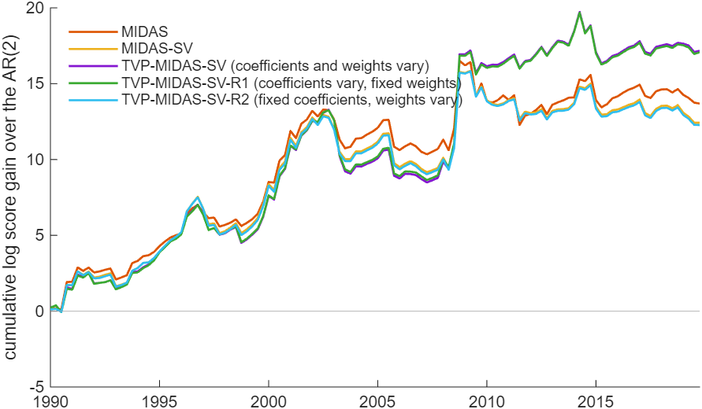
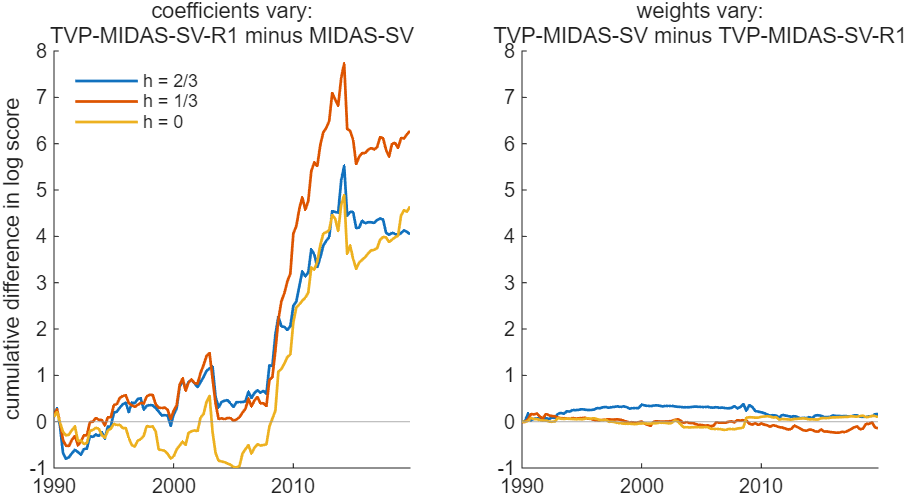
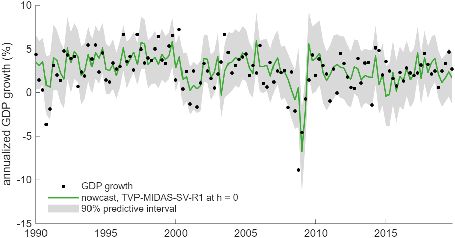

# Which Parameters of a GDP Nowcasting Model Should Vary over Time?

*Code: [`build.m`](build.m) and [`your_data.m`](your_data.m), which call
[`ssm.models.tvp_midas`](../../core/+ssm/+models/tvp_midas.m) and
[`ssm.midas_basis`](../../core/+ssm/midas_basis.m). Method:
[Chan, Poon and Zhu (2026)](../../CITING.md#chan-poon-and-zhu-2026),
[Ghysels, Sinko and Valkanov (2007)](../../CITING.md#ghysels-sinko-and-valkanov-2007),
[Chan and Jeliazkov (2009)](../../CITING.md#chan-and-jeliazkov-2009),
[Kim, Shephard and Chib (1998)](../../CITING.md#kim-shephard-and-chib-1998) and
[Rue and Held (2005)](../../CITING.md#rue-and-held-2005).*

In this tutorial we nowcast US real GDP growth at the end of each month of the quarter with the
mixed-data sampling (MIDAS) regressions of Chan, Poon and Zhu (2026). The predictors are monthly
industrial production, the weekly National Financial Conditions Index (NFCI) and the daily spread
between the 10-year and the 3-month Treasury yields. A MIDAS regression summarizes the
observations of a high-frequency predictor by a weighted average, with weights from a weighting
function. A coefficient multiplies the average and measures the overall impact of the predictor
(Ghysels, Santa-Clara and Valkanov, 2006; Ghysels, Sinko and Valkanov, 2007). Chan, Poon and Zhu
(2026) let both the coefficients and the weights vary over time. We compare five versions that
switch these features on and off, and an AR(2), on the 120 quarters from 1990Q1 to 2019Q4. The
nowcasts are pseudo real time: each model is re-estimated at every origin on today's revised data,
with the release lags of the paper.

In this exercise, letting the coefficients vary over time improves the nowcasts, and letting the
weights vary adds little. The two models whose coefficients vary, TVP-MIDAS-SV and
TVP-MIDAS-SV-R1, nowcast best by every measure. Their nowcasts are nearly the same, so
TVP-MIDAS-SV-R1, with fixed weights, is the simpler starting point. From the end of the second
month of the quarter, their root mean squared forecast error (RMSFE) is 9 to 10 percent below the
AR(2)'s. Over the same horizons, their log predictive likelihood is about 17 above that of the
AR(2). Their advantage over the models with constant coefficients comes almost entirely after 2008
(Figure 2 and Table 2). Letting only the weights vary, in TVP-MIDAS-SV-R2, gives the accuracy of
constant parameters. Chan, Poon and Zhu (2026), with real-time data, also find the versions with
only time-varying coefficients the most accurate.

## Try It Now

Two commands, from the root of the repository:

| Command | What it produces | Time |
|---|---|---|
| `run tutorials/midas_nowcast/your_data.m` | the six models on the same data with short chains, nowcasting the last two quarters at all three horizons and the quarter after the last one observed, and the exported report | about a minute |
| `run tutorials/midas_nowcast/build.m` | every number and figure on this page | about three hours with 8 CPUs |

The short run checks that the workflow runs end to end. Its two quarters are far too few for the
numbers on this page, which all come from the full build. Its settings block is where you point it
at your own files.



*Figure 1: The cumulative difference in log predictive score of each MIDAS model against the
AR(2), plotted at the target quarter. The nowcasts are made at the end of the quarter (h = 0).
Every model gains on the AR(2) over the sample, most in the fourth quarter of 2008.*

## The Six Models

GDP growth $`y_t`$ is 400 times the log change of real GDP. The MIDAS regressions of Chan, Poon
and Zhu (2026) take the form

$$y_t = \alpha_t + \rho_t y_{t-1} + \sum_{m=1}^{3}\gamma_{mt}z_{mt} + \sum_{j=1}^{2}\beta_{jt}\,\boldsymbol{\theta}_{jt}'\mathbf{w}_{jt} + \varepsilon_t, \qquad \varepsilon_t \sim \mathcal{N}(0, \mathrm{e}^{g_t}),$$

where $`z_{1t}, z_{2t}, z_{3t}`$ are the three latest monthly values of industrial production
growth available at the origin, each with its own coefficient. The index $`j`$ is 1 for the NFCI
and 2 for the spread.

Let $`x_{jtk}`$, $`k = 1, \ldots, n_{jt}`$, be the observations of predictor $`j`$ in the three
months ending at the origin that are released by then. The position of observation $`k`$ in this
window is $`s_{jtk} = (\text{origin} - \text{date})/(\text{window length})`$, from 0 at the origin
to 1 at the start of the window. Its weight is

$$B(s_{jtk}; \boldsymbol{\theta}_{jt}) = \frac{\boldsymbol{\theta}_{jt}'\mathbf{v}(s_{jtk})}{n_{jt}}, \qquad \mathbf{v}(s) = (1, \cos 2\pi s, \sin 2\pi s, \cos 4\pi s, \sin 4\pi s)',$$

where $`\mathbf{v}(s)`$ is a Fourier basis, so the dates of the observations enter the weights.
The weighting function, the weight as a function of the position $`s`$, is unknown, and the five
basis functions approximate it. The weighted average is then linear in
$`\boldsymbol{\theta}_{jt}`$:

$$\sum_{k=1}^{n_{jt}} B(s_{jtk}; \boldsymbol{\theta}_{jt})\,x_{jtk} = \boldsymbol{\theta}_{jt}'\mathbf{w}_{jt}, \qquad \mathbf{w}_{jt} = \frac{1}{n_{jt}}\sum_{k=1}^{n_{jt}}\mathbf{v}(s_{jtk})\,x_{jtk}.$$

The basis keeps five parameters per predictor, however many observations the window holds. The
weights of each quarter sum to one: $`\mathbf{a}_{jt}'\boldsymbol{\theta}_{jt} = 1`$, where
$`\mathbf{a}_{jt} = \sum_k \mathbf{v}(s_{jtk})/n_{jt}`$ is the mean of the basis over the window.
This linear restriction identifies $`\beta_{jt}`$ as the overall impact of the predictor. Since
the dates of the observations shift from quarter to quarter, the models with fixed weights impose
the restriction on average over the quarters, the target quarter included. In TVP-MIDAS-SV-R1 for
2019Q4 at h = 0, the weights of a quarter then sum to between 0.97 and 1.02 for the NFCI and
between 0.97 and 1.08 for the spread.

| Model | Coefficients $`(\alpha_t, \rho_t, \boldsymbol{\gamma}_t, \boldsymbol{\beta}_t)`$ | Weights $`\boldsymbol{\theta}_{jt}`$ | Volatility $`g_t`$ |
|---|---|---|---|
| AR(2) | constant, on $`y_{t-1}`$ and $`y_{t-2}`$ | none | constant |
| MIDAS | constant | constant | constant |
| MIDAS-SV | constant | constant | random walk |
| TVP-MIDAS-SV | random walk | random walk | random walk |
| TVP-MIDAS-SV-R1 | random walk | constant | random walk |
| TVP-MIDAS-SV-R2 | constant | random walk | random walk |

We follow Chan, Poon and Zhu (2026) to set the priors. The initial time-varying coefficients and
weights are $`\mathcal{N}(\mathbf{0}, 10\mathbf{I})`$, as are the constant ones. The variances of
their random walks are $`\mathcal{IG}(5, 0.004)`$ for the coefficients and
$`\mathcal{IG}(10, 0.001)`$ for the weights. The log-volatility starts from
$`g_1 \sim \mathcal{N}(0, 10)`$, with innovation variance $`\mathcal{IG}(5, 0.04)`$, where
$`\mathcal{IG}(\nu, S)`$ has density proportional to $`x^{-(\nu+1)}\mathrm{e}^{-S/x}`$. We assume
the constant variance follows $`\mathcal{IG}(5, 16)`$, with mean 4. We give the AR(2) the priors
of the constant-parameter MIDAS regressions. The paper sets these values for weights
$`\boldsymbol{\theta}_{jt}'\mathbf{v}(s_{jtk})`$, without the division by $`n_{jt}`$. On the scale
of this tutorial, the same values keep the initial weights closer to equal and let them move
less, both by a factor of about $`n_{jt}`$ in standard deviation. The prior check under What Can
Go Wrong uses the paper's scale for the variances of the weights.

## The Function Call

Each model is one call to [`ssm.models.tvp_midas`](../../core/+ssm/+models/tvp_midas.m). Before
it, [`ssm.midas_basis`](../../core/+ssm/midas_basis.m) turns the observations of each weekly or
daily predictor into $`\mathbf{w}_{jt}`$ and $`\mathbf{a}_{jt}`$. For TVP-MIDAS-SV-R1 at one
origin:

```matlab
for j = 1:2                                    % the NFCI and the spread
    [W{j}, A{j}] = ssm.midas_basis(d{j}, x{j}, wstart, wend, 'release', r{j});
end
res = ssm.models.tvp_midas(y, X, W, A, 'tvb', true, 'tvtheta', false, 'sv', true, ...
    'nsim', 10000, 'burnin', 5000);
res.nowcast.mean                               % the point nowcast
res.nowcast.q                                  % its 5, 10, 50, 90 and 95 percent quantiles
```

| Argument | Sets | In this tutorial |
|---|---|---|
| `d{j}`, `x{j}` | the dates and values of the observations $`x_{jtk}`$ | the weekly NFCI and the daily spread |
| `wstart`, `wend` | the window of each quarter, which starts after `wstart`, ends at `wend` and fixes $`s_{jtk}`$ | the three months ending at the origin |
| `'release'`, `r{j}` | the release dates of the observations; an observation enters a window only if released by its end | the release days of the NFCI; the dates of the spread |
| `y` | $`y_t`$ for the quarters before the target | GDP growth from 1982Q2 |
| `X` | $`(1, y_{t-1}, z_{1t}, z_{2t}, z_{3t})`$, with a last row for the target quarter | the intercept, last quarter's growth and three months of industrial production |
| `W{j}`, `A{j}` | $`\mathbf{w}_{jt}`$ and $`\mathbf{a}_{jt}`$, with a last row for the target quarter | from `ssm.midas_basis` |
| `'tvb'` | random walks for $`\alpha_t`$, $`\rho_t`$, $`\boldsymbol{\gamma}_t`$ and $`\boldsymbol{\beta}_t`$ | true in TVP-MIDAS-SV and TVP-MIDAS-SV-R1 |
| `'tvtheta'` | random walks for $`\boldsymbol{\theta}_{jt}`$ | true in TVP-MIDAS-SV and TVP-MIDAS-SV-R2 |
| `'sv'` | a random walk for $`g_t`$ | true in all but MIDAS |
| `'prior'` | the priors above | the defaults, the paper's values |
| `'nsim'`, `'burnin'` | the draws kept and the draws discarded first | 10,000 and 5,000, the paper's chain length |

Each sweep of the sampler takes four steps:

1. The coefficients, given the weights, by
   [`ssm.simulate_states`](../../core/+ssm/simulate_states.m), the precision sampler of Chan and
   Jeliazkov (2009).
2. The weights of each predictor, given the coefficients, by `ssm.simulate_states` followed by
   [`ssm.restrict`](../../core/+ssm/restrict.m), which conditions the draw on the restrictions of
   every quarter, the target's included (Algorithm 2.6 of Rue and Held, 2005).
3. The log-volatility, by [`ssm.ksc_rw_diffuse`](../../core/+ssm/ksc_rw_diffuse.m), the
   auxiliary mixture sampler of Kim, Shephard and Chib (1998). It approximates the log
   chi-squared distribution of each log squared standardized error by a mixture of seven normal
   distributions.
4. The variances of the random walks, and the error variance in the models with constant
   volatility.

The target quarter is the last quarter of the weights' random walks. It has no GDP observation,
and its restriction holds in every draw of the weights. Each draw moves the time-varying
coefficients and log-volatility one quarter on along their random walks. Given these draws, the
nowcast is normal. The predictive density is the average of these normal densities
over the draws, the point nowcast the average of their means, and the quantiles those of the
mixture.

## Results for US GDP

The data are [`examples/data/USGDP.csv`](../../examples/data/USGDP.csv) for real GDP,
[`examples/data/FRED-MD.csv`](../../examples/data/FRED-MD.csv) for industrial production,
[`examples/data/NFCI_weekly.csv`](../../examples/data/NFCI_weekly.csv) and
[`examples/data/T10Y3M_daily.csv`](../../examples/data/T10Y3M_daily.csv). The target quarters run
from 1990Q1 to 2019Q4. At each of the three origins of a target quarter, every model is
re-estimated on the quarters from 1982Q2 up to the one before the target. The data are today's
revised series, so the nowcasts are pseudo real time.

*Table 1: Nowcasts of GDP growth for 1990Q1-2019Q4, 120 quarters, at the end of each month of the
quarter (h = 2/3, 1/3 and 0). All scores are relative to the AR(2). The RMSFE and the average
quantile score at 10 percent are ratios, and the log score is the difference in the sums of log
predictive likelihoods. The AR(2) nowcast of a quarter is the same at its three origins. Its RMSFE
is 2.19 and its sum of log predictive likelihoods -264.4.*

| Model | RMSFE, h = 2/3 | 1/3 | 0 | Log score, h = 2/3 | 1/3 | 0 | Quantile score, h = 2/3 | 1/3 | 0 |
|---|---|---|---|---|---|---|---|---|---|
| MIDAS | 0.984 | 0.942 | 0.928 | 4.7 | 11.5 | 13.7 | 0.977 | 0.876 | 0.862 |
| MIDAS-SV | 0.978 | 0.941 | 0.937 | 5.3 | 10.7 | 12.4 | 0.990 | 0.877 | 0.853 |
| TVP-MIDAS-SV | 0.946 | 0.897 | 0.906 | 9.5 | 16.9 | 17.2 | 0.971 | 0.835 | 0.831 |
| TVP-MIDAS-SV-R1 | 0.950 | 0.900 | 0.906 | 9.4 | 17.0 | 17.1 | 0.975 | 0.842 | 0.833 |
| TVP-MIDAS-SV-R2 | 0.977 | 0.943 | 0.938 | 5.3 | 10.3 | 12.3 | 0.983 | 0.877 | 0.853 |

The RMSFE scores the point nowcast, the mean of the predictive distribution. The log predictive
likelihood scores the whole distribution: it is the log of the predictive density at the outcome,
summed over the 120 nowcasts. The quantile score at 10 percent,
$`(\mathbf{1}\{y \le q\} - 0.1)(q - y)`$ for the predictive 10 percent quantile $`q`$, scores the
left tail. The 90 percent predictive intervals contain between 87 and 91 percent of the outcomes
for every model and horizon.

The AR(2) uses none of the quarter's data, and every MIDAS model gains on it as these data come
in. At the end of the first month, the RMSFE of the MIDAS models is 1.6 to 5.4 percent below the
AR(2)'s. From the end of the second month, it is 5.7 to 10.3 percent below, and the data of the
third month add little.

### Time-Varying Coefficients or Time-Varying Weights?

TVP-MIDAS-SV and TVP-MIDAS-SV-R1 differ in whether the weights vary, and so in how their
restriction holds: in every quarter, or on average over the sample. Their scores agree to within
0.2 in the log predictive likelihood and 0.004 in the relative RMSFE at each horizon.
TVP-MIDAS-SV-R2 and MIDAS-SV differ the same way, with the coefficients held constant, and agree
to within 0.5 and 0.002. Time variation in the coefficients lowers the RMSFE by 3 to 4 percent of
the AR(2)'s and raises the log predictive likelihood by 4 to 6. Under the priors used here, time
variation in the weights adds little to either. The same holds with the paper's scale for the
prior on how fast the weights move. Figure 2 shows both comparisons quarter by quarter, and Table
2 splits them at 2008.



*Figure 2: The cumulative difference in log predictive score between two models that differ in one
feature, at each horizon, plotted at the target quarter. Left: time-varying coefficients, with
fixed weights in both models. Right: time-varying weights, with time-varying coefficients in both
models.*

*Table 2: The difference in the sums of log predictive likelihoods between two models that differ
in one feature, by subperiod.*

| Comparison | 1990Q1-2007Q4, h = 2/3 | 1/3 | 0 | 2008Q1-2019Q4, h = 2/3 | 1/3 | 0 |
|---|---|---|---|---|---|---|
| Coefficients vary: TVP-MIDAS-SV-R1 minus MIDAS-SV | 0.6 | 0.3 | -0.5 | 3.4 | 5.9 | 5.1 |
| Weights vary: TVP-MIDAS-SV minus TVP-MIDAS-SV-R1 | 0.3 | 0.0 | -0.2 | -0.2 | -0.1 | 0.3 |
| Weights vary: TVP-MIDAS-SV-R2 minus MIDAS-SV | 0.1 | -0.3 | -0.1 | -0.1 | -0.2 | 0.0 |

The gain from time-varying coefficients comes after 2008. Over 1990-2007, TVP-MIDAS-SV-R1 and
MIDAS-SV differ by at most 0.6 in log predictive likelihood at any horizon; over 2008-2019,
TVP-MIDAS-SV-R1 gains 3.4 to 5.9.



*Figure 3: Real GDP growth (dots) and its recursive nowcast from TVP-MIDAS-SV-R1 at the end of the
quarter (h = 0), with the 90 percent predictive interval. Each nowcast uses the information set of
its origin, in today's revised data. The nowcast misses the fall of 2008Q4, -8.9 percent against a
nowcast of 0.6, and catches that of 2009Q1, -4.6 against -6.7. Of the 120 outcomes, 14 fall
outside the interval.*

## The Information at Each Origin

The information at each origin follows Table 2 of Chan, Poon and Zhu (2026). At the end of month
$`i`$ of a quarter, GDP is known up to the previous quarter and the spread up to that day.
Industrial production is released a month late, so it is known up to month $`i - 1`$. The NFCI of
a week, which ends on a Friday, is released on the following Wednesday, or on the Thursday when a
federal holiday falls earlier in that week. At the end of January 2000, for example, the latest
NFCI is that of 21 January, released on 26 January. Each origin has its own regression, and every
quarter of its sample is aligned to that origin in the same way. The three monthly regressors are
the three months before the origin's month. The weekly and daily observations are those of the
three months ending at the origin that are released by then. A weekly window holds 12 or 13
observations and a daily window 59 to 65.

## Checking the Sampler

The build checks the data before it runs the nowcasts. The information sets of 2000Q1 are those of
the paper's Table 2, with industrial production up to December, January and February at the three
origins. Every quarter's monthly regressors move one month from one origin to the next. The build
then runs TVP-MIDAS-SV, with every variance estimated, on data generated from the model with the
regressors of the US data. The 90 percent bands of the 150 quarters contain 83.0 percent of the
true coefficients. The data say little about the shape of the weights, so their bands follow the
prior, and how many true weights they contain depends on where in the prior these were drawn.
Here the bands contain 75.3 percent of the true NFCI weights and 49.7 percent of the true spread
weights. The restrictions hold in every draw to 7e-14. Over every draw of the 2,160 runs, the
largest restriction residual is 3.0e-11.

## What Can Go Wrong

- **Data released after the origin.** A nowcast may use only the data published by its origin. If
  `mlag` is shorter than the publication lag of a monthly predictor, or a window ends after the
  origin, the nowcasts use data that a forecaster at the origin did not have. The build checks the
  information sets of 2000Q1 against Table 2 of the paper before it runs the nowcasts.
- **Revised data.** The data files hold today's revised series, so the nowcasts are pseudo real
  time. Chan, Poon and Zhu (2026) score their nowcasts on real-time vintages, and scores on
  revised data can differ.
- **The prior on the variances of the weights.** The data say almost nothing about how fast the
  weights move. In TVP-MIDAS-SV at h = 0, the posterior means of these variances stay within 10
  percent of their prior means, so the prior sets how far the weights can move. On the scale of
  the paper, the prior is $`\mathcal{IG}(10, 0.001\,n_j^2)`$, with $`n_j`$ the typical number of
  observations in a window: 12 for the NFCI and 62 for the spread. With this prior at h = 0, the
  relative RMSFE of TVP-MIDAS-SV and TVP-MIDAS-SV-R2 is 0.908 and 0.938, and their log scores
  17.2 and 12.6. With the prior of this tutorial, Table 1 has 0.906 and 0.938, and 17.2 and 12.3.
  Time-varying weights add little under either prior.
- **A window without observations.** `ssm.midas_basis` stops with an error when a weekly or daily
  window holds no observation, as for a predictor that starts after the first quarter of the
  sample. Start the sample later, or leave the predictor out.

## Applying the Method to Your Data

The script [`your_data.m`](your_data.m) runs the same comparison on a quarterly target of your
own. Its settings block names the files and columns of the target and of the monthly, weekly or
daily predictors. It sets whether to turn the target's levels into 400 times their log changes.
For the monthly predictors, it sets their transformation and the months by which they are released
late. For the weekly and daily predictors, it sets the dates on which their values are released.
It also sets the first quarter of the estimation sample, the models to compare, the number
of quarters to nowcast, the draws per model and the seed. Last, it sets whether to nowcast the
quarter after the last one observed, and where the report goes. Each monthly predictor enters as
its three latest available months, and each weekly or daily predictor through a weighting function
over the three months ending at the origin.

Every input is a csv file whose first column is a date. The date is written as yyyy-MM-dd or
M/d/yyyy, or as year + month/12 in the convention of the FRED-MD file. The tutorial's target and
daily spread begin like this:

```text
observation_date,GDPC1
1/1/1947,2182.681
4/1/1947,2176.892
```

```text
observation_date,T10Y3M
1982-01-04,2.32
1982-01-05,2.24
```

and the settings that read them, with the monthly and weekly files, are

```matlab
d = fullfile(repo, 'examples', 'data');
qfile = fullfile(d, 'USGDP.csv'); qcol = 'GDPC1'; qtransform = 'dlog400';
mfile = fullfile(d, 'FRED-MD.csv'); mcols = {'INDPRO'}; mtransform = 'none'; mscale = 100;
mlag = 1;                          % months by which the monthly predictors are released late
hfiles = {fullfile(d, 'NFCI_weekly.csv'), fullfile(d, 'T10Y3M_daily.csv')};
hcols = {'NFCI', 'T10Y3M'};
hrelease = {@nfci_release, []};    % the release dates of each weekly or daily predictor
```

- **Levels or growth rates.** The target is in levels and becomes 400 times its log change
  (`qtransform = 'dlog400'`), or is used as it is (`'none'`). Monthly predictors are
  log-differenced (`mtransform = 'dlog'`) or not, and then multiplied by `mscale`. The FRED-MD
  file already holds the log change of industrial production, hence `'none'` and 100. Weekly and
  daily predictors are used as they are.
- **Missing values.** Missing values at the start or end of the target are dropped, and a gap
  inside it stops the script. A month with a missing value in any monthly predictor is dropped,
  and the months left must run without gaps. Missing weekly or daily values, such as the spread on
  holidays, are dropped, and every window must keep at least one observation.
- **Timing.** A weekly or daily value enters each nowcast whose window, the three months ending at
  the origin, contains its date, once the value is released. For each weekly or daily predictor,
  `hrelease` holds a function that turns its dates into release dates, or `[]` when its values
  are released on their dates. The defaults are `nfci_release` for the NFCI, which gives the
  Wednesday or Thursday after each week, and `[]` for the spread. A monthly value enters `mlag`
  months after its month. The script does not model data revisions, so with today's files the
  nowcasts of past quarters are pseudo real time, as in this tutorial.

With the latest data, `latest = true` gives the nowcast a forecaster wants. This is each model's
nowcast of the next quarter, at the latest month-end that all the predictors reach: the monthly
predictors up to their release lag, and each weekly or daily one with a release in the last seven
days of the month. The script
writes two files to `outdir`, which defaults to `tempdir` so that a run leaves the repository
unchanged. The first, `midas_nowcast_report.csv`, has one row per model, with its scores and that
nowcast with its 90 percent interval. The second, `midas_nowcast_report.mat`, holds the table with
the settings behind it.

## Reproducing the Results

To reproduce all results on this page, run the build script from the root of the repository:

```matlab
run tutorials/midas_nowcast/build.m
```

The script `build.m` checks the data and the sampler, runs the 1,920 nowcasts and the 240 of the
prior check, scores them and draws the figures. With the Parallel Computing Toolbox it runs the
nowcasts on parallel workers, and without it one after another, which takes several times as
long. Each nowcast has its own seed, so the parallel and the serial runs give the same numbers.
Each also has its own file in `runs/`, which is not part of the repository, so an interrupted
build resumes where it stopped. A file is used again only if its settings, its data and the
version of the code are those of the run. The computation takes about three hours with 8 CPUs,
using MATLAB R2025b on a computer with an Intel Core Ultra 7 255U processor and 32 GB of RAM.

The script prints every result in this tutorial, or the numbers they are computed from. It saves
the figures in the same folder as this page, together with [`nowcasts.csv`](nowcasts.csv), which
holds every nowcast. The file has one row per model, target quarter and origin, with the outcome,
the point nowcast, the 5, 10, 50 and 95 percent quantiles and the log predictive density.

## References

Chan, J. C. C. and Jeliazkov, I. (2009). Efficient Simulation and Integrated Likelihood Estimation
in State Space Models. *International Journal of Mathematical Modelling and Numerical
Optimisation*, 1(1/2): 101-120.
[doi:10.1504/IJMMNO.2009.030090](https://doi.org/10.1504/IJMMNO.2009.030090)

Chan, J. C. C., Poon, A. and Zhu, D. (2026). Time-Varying Parameter MIDAS Models: Application to
Nowcasting US Real GDP. *Journal of Econometrics*, forthcoming.
[doi:10.1016/j.jeconom.2025.106090](https://doi.org/10.1016/j.jeconom.2025.106090)

Ghysels, E., Santa-Clara, P. and Valkanov, R. (2006). Predicting Volatility: Getting the Most out
of Return Data Sampled at Different Frequencies. *Journal of Econometrics*, 131(1-2): 59-95.
[doi:10.1016/j.jeconom.2005.01.004](https://doi.org/10.1016/j.jeconom.2005.01.004)

Ghysels, E., Sinko, A. and Valkanov, R. (2007). MIDAS Regressions: Further Results and New
Directions. *Econometric Reviews*, 26(1): 53-90.
[doi:10.1080/07474930600972467](https://doi.org/10.1080/07474930600972467)

Kim, S., Shephard, N. and Chib, S. (1998). Stochastic Volatility: Likelihood Inference and
Comparison with ARCH Models. *Review of Economic Studies*, 65(3): 361-393.
[doi:10.1111/1467-937X.00050](https://doi.org/10.1111/1467-937X.00050)

Rue, H. and Held, L. (2005). *Gaussian Markov Random Fields: Theory and Applications*. Chapman &
Hall/CRC. [doi:10.1201/9780203492024](https://doi.org/10.1201/9780203492024)

[`CITING.md`](../../CITING.md) lists the paper to cite for each model and method. To cite the
toolkit itself: Chan, J. C. C. (2026). *statespace-toolkit: MATLAB code for Bayesian state space
models*. Zenodo. [doi:10.5281/zenodo.22884655](https://doi.org/10.5281/zenodo.22884655)
